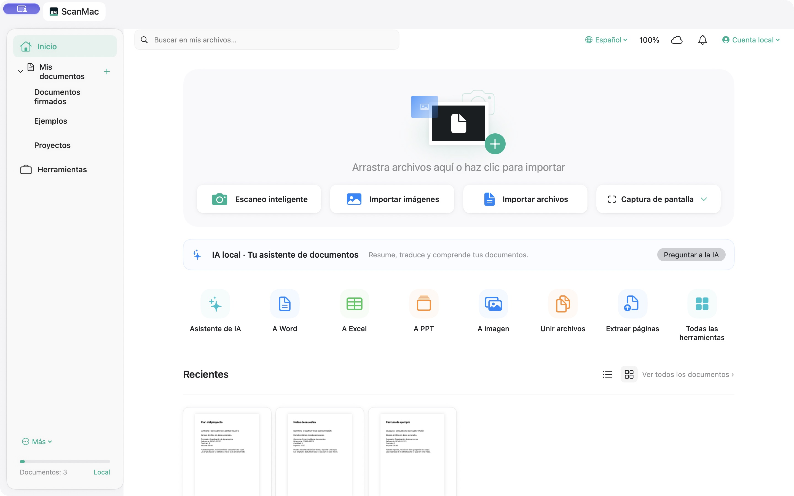

# ScanMac

Aplicación nativa de macOS para organizar documentos, trabajar con PDF y usar OCR e IA local.

**Versión pública de prueba: 0.8.1. Estado experimental.** El código se publica con licencia MIT. No incluye documentos de usuarios, credenciales ni pesos de modelos.

[Descargar para macOS](https://github.com/marreroadvisor/ScanMac/releases/download/v0.8.1/ScanMac-0.8.1-macOS-universal.zip) · [Guía de uso](docs/GUIA.md) · [Cambios](CHANGELOG.md) · [Pruebas automáticas](https://github.com/marreroadvisor/ScanMac/actions)

La descarga tiene firma local y todavía no está notarizada por Apple. Consulta la guía antes de instalar.



## Funciones

- Biblioteca con carpetas y subcarpetas, búsqueda, etiquetas y papelera recuperable.
- Importación de PDF e imágenes; OCR con Apple Vision.
- Unir, extraer, reordenar y girar páginas; anotaciones, firmas dibujadas, marcas de agua y exportación.
- Exportación aproximada a Word, Excel y PowerPoint con texto editable y referencias visuales.
- Asistente con modelos de LM Studio en el propio Mac; integración opcional con Codex local.
- Limpieza por zonas con LaMa y propuestas de un modelo local con visión.
- Clasificador experimental Community Forensics y mapas de posibles alteraciones.
- Investigación con fuentes locales y consulta web opcional, desactivada inicialmente.

## Compilar

Requiere macOS14 o posterior y Xcode con herramientas de línea de comandos. La compilación genera un binario universal para Apple Silicon e Intel.

```sh
zsh build.sh
```

Se generan `ScanMac.app` y `ScanMac.zip`. La firma es local (*ad hoc*): la app no está notarizada por Apple. No se recomienda desactivar las protecciones de macOS para ejecutarla.

## IA local

1. Instala LM Studio desde su sitio oficial y carga un modelo de texto.
2. Activa su servidor en `http://127.0.0.1:1234`.
3. Abre el asistente y elige el modelo. Para proponer zonas en imágenes, carga uno que admita visión.

Si Codex CLI está instalado en una ruta admitida, se intenta su modo local aislado. Si el formato del modelo resulta incompatible, el asistente usa el mismo LM Studio directamente y muestra el motor utilizado. No necesita una clave de OpenAI para esta ruta local.

Para los motores de imágenes, necesitas **Apple Silicon** e instala **Python3.12** y ejecuta:

```sh
python3.12 Engines/install.py
```

El instalador descarga dependencias y dos modelos a `~/Library/Application Support/ScanMac/Engines`. Después, estos motores procesan imágenes sin red. Pesos, revisiones y SHA-256 se describen en [Engines/models.json](Engines/models.json); licencias y funcionamiento en [Engines/README.md](Engines/README.md).

## Datos y privacidad

La biblioteca se guarda en `~/Library/Application Support/ScanMac`, separada de la aplicación y de este repositorio. Los modelos se ejecutan localmente. La búsqueda web requiere activación por consulta y envía el texto escrito en el campo público y las URLs solicitadas; no sube los documentos al buscador. Los enlaces que decidas abrir y las descargas iniciales sí utilizan Internet.

La sincronización de carpetas y el servidor privado son opcionales. Antes de activarlos, revisa qué datos copiarán. El servidor no se inicia públicamente; consulta [Server/README.md](Server/README.md). Las exportaciones y respaldos conservan su propia copia de los datos.

## Límites conocidos

- OCR, tablas, fuentes y diseño Office pueden contener errores. No se ha verificado el renderizado en todas las versiones de Microsoft Office.
- La limpieza reconstruye un fondo plausible; no recupera con certeza texto tapado. Revisa las zonas y la vista previa antes de exportar.
- La puntuación de imagen IA resume cinco recortes, muestra discrepancias y no es una probabilidad calibrada ni certifica autenticidad. Una prueba pequeña de siete imágenes produjo dos positivos entre cuatro etiquetadas reales. No es una evaluación independiente de precisión general.
- ELA, patrones repetidos y diferencias de píxeles son indicios; no validan firmas digitales ni demuestran fraude.
- La investigación web integrada tiene búsqueda enciclopédica y lectura de URLs accesibles, sin navegación de sitios dinámicos ni acceso a fuentes de pago.
- La interfaz tiene63 catálogos; algunas etiquetas recientes usan español o inglés y no todas las traducciones tienen revisión profesional.
- Hardware de captura, Intel y distribución pública necesitan más pruebas.

## Pruebas

En un Mac con Xcode:

```sh
zsh Tests/run-native-text.sh
zsh Tests/run-assistant-skills.sh
zsh Tests/run-tools.sh
zsh Tests/run-library.sh
zsh Tests/run.sh
python3 -m unittest discover -s Server -v
```

Pruebas que consultan fuentes públicas, usando solo una consulta de ejemplo:

```sh
zsh Tests/run-advanced-assistant.sh /private/tmp/scanmac-office-tests
```

La prueba de inferencia necesita LM Studio y el modelo de ejemplo del harness; adapta el identificador si usas otro. Las pruebas de imagen requieren el entorno de motores. Usa únicamente archivos sintéticos o públicos al enviar resultados de pruebas.

## Capturas

Las capturas de la [guía](docs/GUIA.md) muestran datos sintéticos del modo de demostración, separado de la biblioteca real. Puedes reproducirlo compilando y ejecutando con `--demo`.

## Contribuir

Se aceptan correcciones, mejoras de accesibilidad, traducciones y pruebas. Consulta [CONTRIBUTING.md](CONTRIBUTING.md). No adjuntes documentos privados a los informes.

## Licencia

[MIT](LICENSE) para el código y los gráficos propios de ScanMac. Las dependencias y los modelos mantienen sus licencias; consulta [THIRD_PARTY_NOTICES.md](THIRD_PARTY_NOTICES.md).

## Ficha y recorrido visual

[Ficha del programa](FICHA.md) · [Video de 15 segundos](docs/videos/scanmac-tour.mp4) · [Reportar un error](https://github.com/marreroadvisor/ScanMac/issues/new?template=error.yml) · [Proponer una mejora](https://github.com/marreroadvisor/ScanMac/issues/new?template=mejora.yml)

El video es un recorrido de capturas de la interfaz con datos de demostración; no es una grabación de una adquisición o conversión en ejecución.
