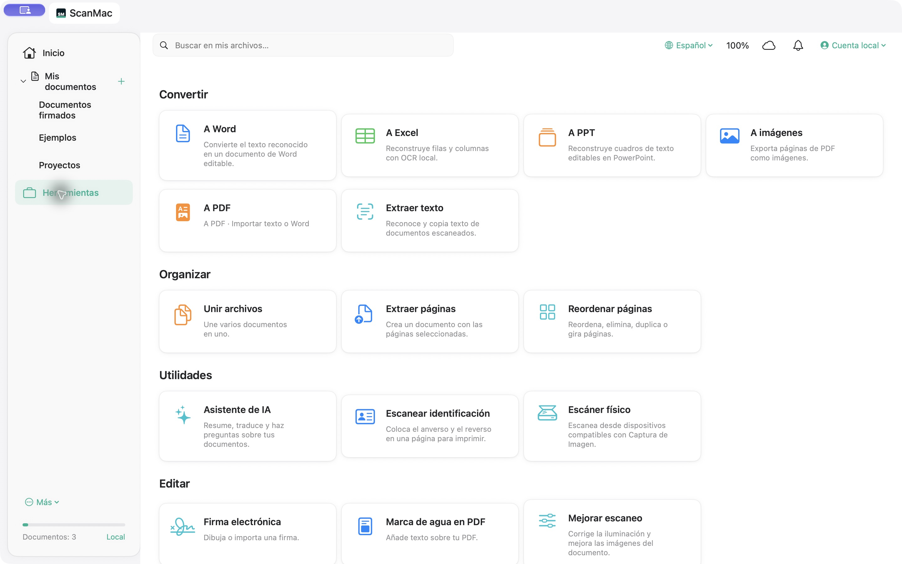
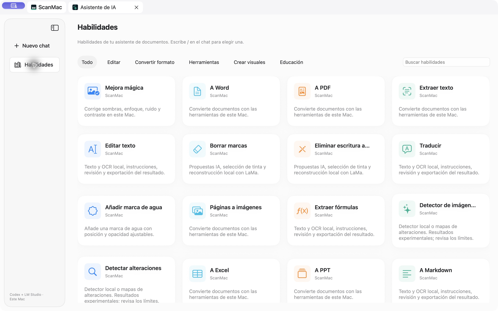

# Guía de inicio de ScanMac

## Descargar y abrir

1. Descarga [ScanMac0.8.1 para macOS](https://github.com/marreroadvisor/ScanMac/releases/download/v0.8.1/ScanMac-0.8.1-macOS-universal.zip).
2. Descomprime el ZIP. Puedes mover `ScanMac.app` a Aplicaciones.
3. Abre la app. Requiere macOS14 o posterior; el ejecutable incluye Apple Silicon e Intel. Las pruebas de uso de esta versión se hicieron en Apple Silicon.

**Versión experimental con firma local, sin notarización de Apple.** macOS puede impedir abrir esta descarga. No desactives las protecciones del sistema. Si no puedes abrirla, puedes revisar el código y compilarlo localmente con Xcode; la firma Developer ID y la notarización siguen pendientes para una distribución sin esa limitación.

No incluye una biblioteca de documentos ni modelos. Actualizar la app no es un respaldo: guarda una copia de los documentos importantes antes de instalar una versión experimental.

## Importar y organizar

Pulsa **Importar archivos** para PDF o **Importar imágenes** para fotos. También puedes arrastrar archivos a Inicio. ScanMac guarda copias en su biblioteca local.

En **Mis documentos**, crea carpetas y subcarpetas. El menú contextual permite organizar, cambiar el nombre, exportar y mover a la papelera. Los archivos de la papelera son recuperables; esta versión no los purga automáticamente.

Las capturas de esta guía usan una biblioteca de demostración aislada y documentos sintéticos. No muestran documentos del propietario del repositorio ni información personal.

## OCR y conversiones

Abre un documento y ejecuta la extracción de texto. Selecciona los idiomas adecuados en **Idiomas OCR** cuando la detección automática no baste.

Los PDF digitales conservan su texto seleccionable al convertir, sin volver a reconocerlo con OCR. Los escaneos usan Apple Vision. Las herramientas muestran cuántas páginas utilizaron cada vía y avisan de confianza baja. La confianza del OCR no garantiza que cada palabra sea correcta.

En **Herramientas**, elige Word, Excel, PowerPoint, imágenes o texto. Revisa la vista previa y guarda el resultado. Word y PowerPoint pueden conservar posiciones y algunos estilos del PDF digital; no todas las tablas ni fuentes se reconstruyen exactamente. Si editas el texto del panel antes de guardar Word, la copia editada utiliza el exportador de texto y simplifica el diseño.

## Asistente de IA

Instala LM Studio desde su web oficial, carga un modelo y activa el servidor local en `http://127.0.0.1:1234`. Abre **Asistente de IA → Habilidades** y selecciona un documento o escribe texto de prueba.

Las respuestas se generan en tu Mac. Si está disponible, se intenta Codex local; ante incompatibilidad del modelo se usa LM Studio directamente y se indica en pantalla. Revisa las respuestas antes de utilizarlas.

## Limpieza y detectores

Los motores de imágenes necesitan **Apple Silicon y Python3.12** en esta versión. No se ha preparado su instalación en Intel. Desde el código descargado, ejecuta `python3.12 Engines/install.py`; se descargan dependencias y pesos por separado.

- **Borrar marcas / escritura:** propone zonas con un modelo local que admita visión o selecciónalas manualmente. Reconstruye el fondo, compara la vista previa y exporta una copia. La selección de tinta de color también puede incluir texto impreso de color.
- **Imagen IA:** revisa cinco recortes y muestra la mediana y el rango de puntuaciones. Una discrepancia grande o resolución baja se señala como inconclusa. No es una prueba de autenticidad.
- **Alteraciones:** muestra mapas ELA, patrones repetidos y diferencias ante un original alineado opcional. Compresión, texto y repetición legítima también producen señales.

## Investigación con fuentes

La búsqueda web empieza desactivada. Si la activas, solo la consulta escrita en el campo público y las URLs que indiques salen a Internet. Tus documentos se analizan localmente. La búsqueda integrada es enciclopédica; añade URLs de fuentes primarias para contrastar. Algunas webs no permiten extraer texto.

## Datos, copias y ayuda

La biblioteca está en `~/Library/Application Support/ScanMac`. No borres esa carpeta al actualizar. El ZIP de la app y el repositorio no contienen tus archivos.

Para reportar un fallo, abre un issue con tu versión de macOS y pasos reproducibles con un PDF sintético. No adjuntes documentos privados, contraseñas, tokens ni índices de biblioteca.
